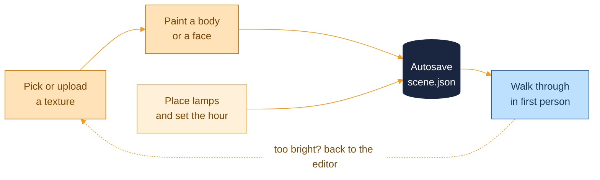

<p align="center">
  <picture>
    <source media="(prefers-color-scheme: dark)" srcset="docs/assets/brand/banner-dark.svg">
    
  </picture>
</p>

<p align="center">
  <a href="https://github.com/kfeuerschvenger/walkthrough-studio/actions/workflows/ci.yml"></a>
  <a href="LICENSE"></a>
  
  
  
  
  
  
  
</p>

<p align="center"><strong>English</strong> · <a href="README_es.md">Español</a></p>

<p align="center">
  
</p>

**Walkthrough Studio is a 3D house viewer with a paint and lighting editor, built to try things on a home before touching a single wall.**

Load a model, walk through it in first person, and paint walls and floors with any image you upload. Drop in lamps, then drag the clock and watch the same room go from noon to night. Measure twice, paint once, except here you can repaint as many times as you like for free.

The project started as a way to plan a real home: furniture, appliances, lights and finishes, judged in the room itself instead of on a swatch card. The sun does the lighting work for free, so you can see how the living room looks at 6 PM without waiting for 6 PM, and you can try fourteen tile options without ever visiting a hardware store.

The interface ships in Spanish for now; code and docs are in English, and a language switch is the first item on the [roadmap](docs/ROADMAP.md).

## Take the tour

<table>
  <tr>
    <td width="50%" valign="top">
      
      <p><strong>Walk in.</strong> First-person controls, a sprint key and a fly mode. The same scene you painted in the editor is waiting, textures and lamps included.</p>
    </td>
    <td width="50%" valign="top">
      
      <p><strong>Same room, 6 PM.</strong> One slider moves the sun, the sky, the shadows and the moon. Lamps fade in as the light goes, so evening looks like evening.</p>
    </td>
  </tr>
  <tr>
    <td width="50%" valign="top">
      
      <p><strong>Paint a whole body or a single face.</strong> Upload an image, pick it, and click. Flood-filled faces let you give one wall its own colour even when the model is a single mesh.</p>
    </td>
    <td width="50%" valign="top">
      
      <p><strong>Lights you can grab.</strong> Box, sphere and spot emitters with a move, rotate and scale gizmo, a colour and an intensity. Try the lamp in the corner before you drill the ceiling.</p>
    </td>
  </tr>
</table>

### Why it feels like a workshop

- **Textures that ignore UVs.** Painting uses triplanar projection, so a CAD export with unusable UVs looks as good as a game-ready model, and the tile size is set in real meters.
- **Autosave you can trust.** Every change is saved to the server a moment after you stop touching it, one write at a time, so closing the tab never eats your wall.
- **One scene, two views.** The editor and the walkthrough read the same saved scene, so there is no export step between painting and walking.
- **Your house, not just ours.** A CC0 demo house is bundled, and any FBX or glTF model can take its place.

Everything you do in the editor ends up in the walkthrough:



## Under the hood

<picture>
  <source media="(prefers-color-scheme: dark)" srcset="docs/assets/diagrams/architecture-dark.svg">
  
</picture>

A React single page app renders the scene with three.js through react-three-fiber, and keeps everything that persists in one provider. A small Express API validates each request, writes files atomically through a single queue, and refuses requests from other origins, because it has no login and listens on loopback by default. Paints are stored as a few numbers per face and rediscovered by flood fill on every load, so a saved scene stays tiny.

<p align="center">
  &nbsp;
  &nbsp;
  &nbsp;
  &nbsp;
  &nbsp;
  &nbsp;
  &nbsp;
  &nbsp;
  &nbsp;
  
</p>

## Quick start

You need Node 22 or newer.

```bash
npm install
npm run dev
```

Open http://localhost:5173 and pick the walkthrough or the scene editor.

> [!TIP]
> Prefer a container? `docker compose up -d` builds the image and serves everything on http://localhost:3001. Every variable, the Docker details and LAN access are in [ENVIRONMENT.md](docs/ENVIRONMENT.md).

## Bring your own house

The bundled house is a small demo assembled from CC0 pieces. To walk through your own model, point the app at an FBX or glTF file with `VITE_HOUSE_URL`, and tell it where to start with `VITE_HOUSE_SPAWN`:

```bash
# .env.local
VITE_HOUSE_URL=/models/MyHouse.fbx
VITE_HOUSE_SPAWN=0,0
```

The API serves the folder named by `MODELS_DIR` at `/models`, so start it with `MODELS_DIR=./models`. Models stay out of git: the `*.fbx` pattern is ignored, and in Docker the folder is mounted read-only at `/models`. Units, the up axis and the ground level are detected at load time. The full recipe, including the sun direction and the ground hints, is in [ENVIRONMENT.md](docs/ENVIRONMENT.md#bring-your-own-house).

## Dive deeper

The README is the showroom. The deep docs are the workshop.

| Document | The hook |
|---|---|
| [Architecture](docs/ARCHITECTURE.md) | The frontend, how a scene is saved, triplanar and per-face painting, the sun and the lights, and the server |
| [Environment](docs/ENVIRONMENT.md) | Every variable and script, Docker, your own model and LAN access |
| [Controls](docs/CONTROLS.md) | Keyboard and mouse for the walkthrough and the editor |
| [API](docs/API.md) | The scene and texture endpoints, limits and error answers |
| [Testing](docs/TESTING.md) | What each suite covers, how to run it, and the pipeline that takes these screenshots |
| [CI](docs/CI.md) | The three jobs, the audit gate and the branch flow |
| [Roadmap](docs/ROADMAP.md) | What comes next, starting with a language switch |

---

<p align="center">
  <strong>Made in Patagonia · 50°20′S</strong><br>
  Built with care (and a lot of paint swatches) by <strong>Kevin Feuerschvenger</strong> · Software Engineer
</p>

<p align="center">
  <a href="https://github.com/kfeuerschvenger"></a>
  <a href="https://www.linkedin.com/in/kevin-feuerschvenger/"></a>
  <a href="https://feuerschvenger.com/"></a>
</p>

<p align="center"><sub>Released under the <a href="LICENSE">MIT licence</a>, with third-party assets credited there.</sub></p>
