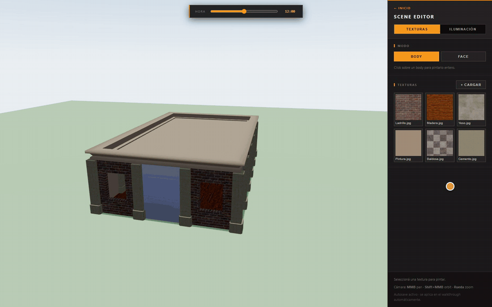
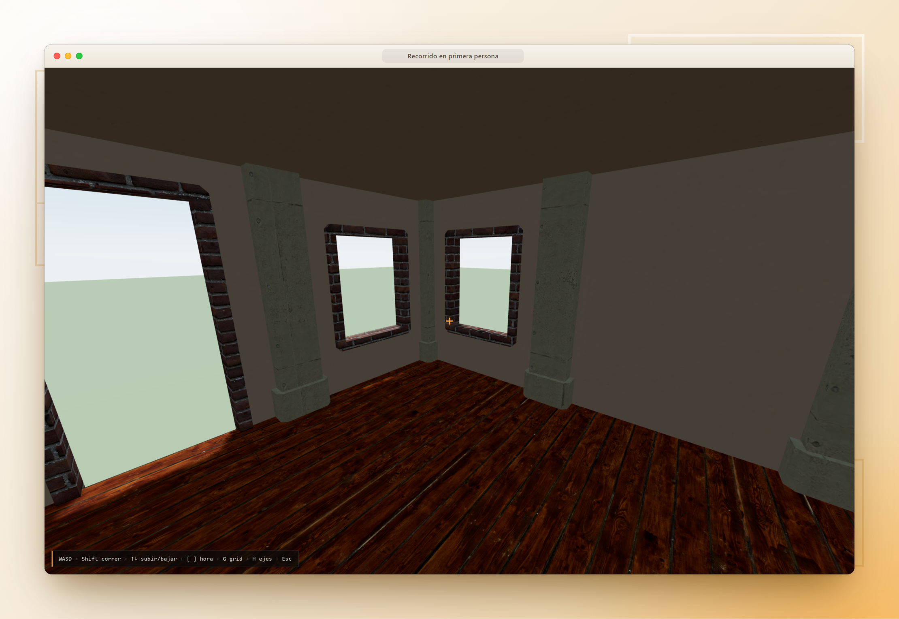
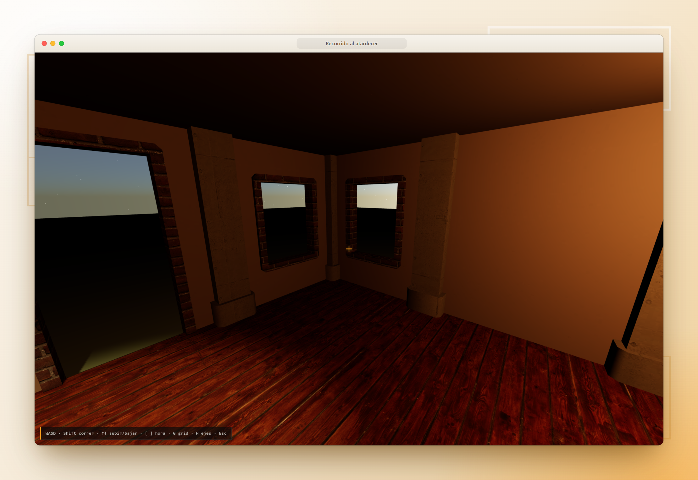
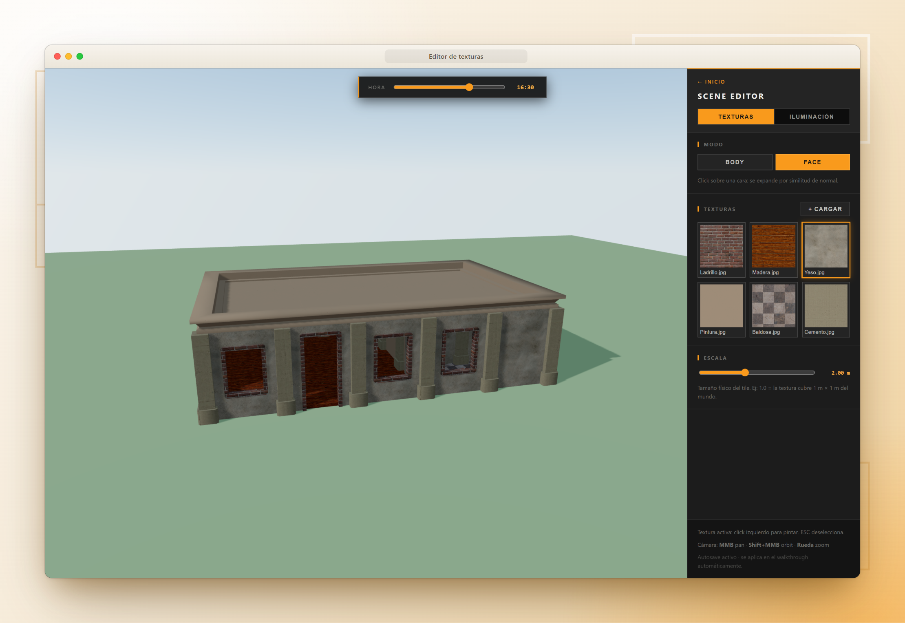
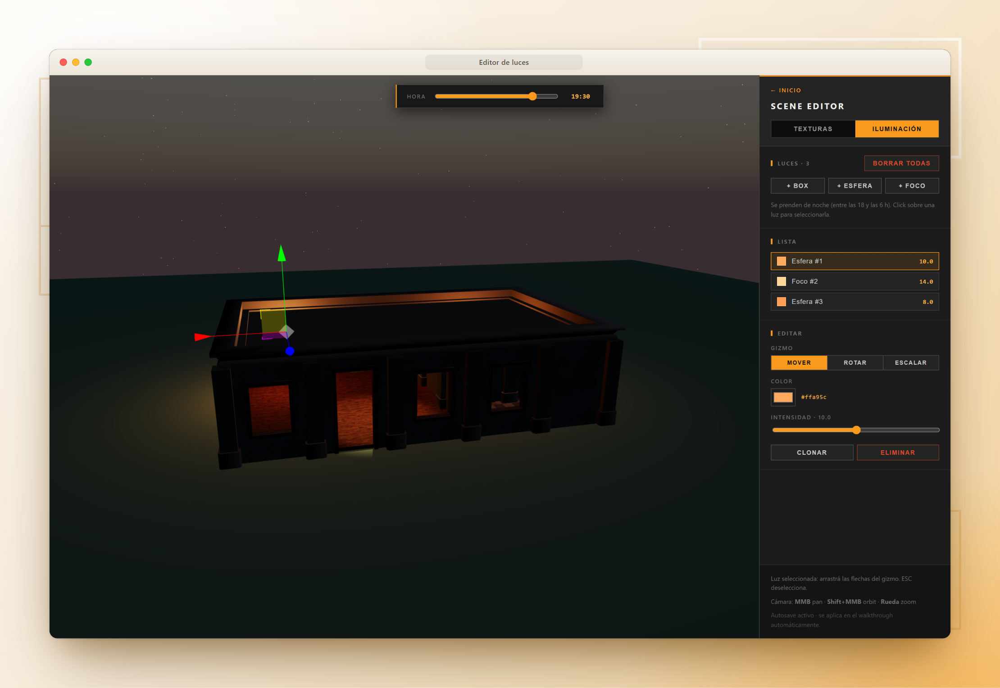
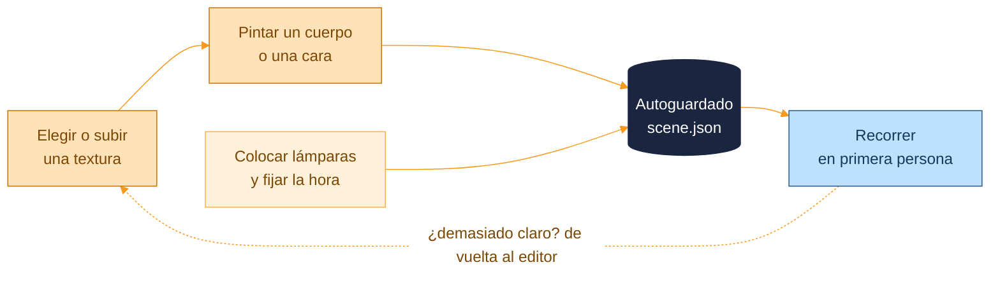
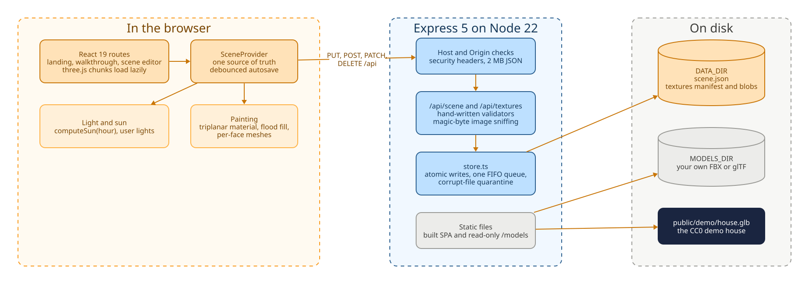

<p align="center">
  <picture>
    <source media="(prefers-color-scheme: dark)" srcset="docs/assets/brand/banner-dark.svg">
    
  </picture>
</p>

<p align="center">
  <a href="https://github.com/kfeuerschvenger/walkthrough-studio/actions/workflows/ci.yml"></a>
  <a href="LICENSE"></a>
  
  
  
  
  
  
  
</p>

<p align="center"><a href="README.md">English</a> · <strong>Español</strong></p>

<p align="center">
  
</p>

**Walkthrough Studio es un visor 3D de casas con un editor de pintura e iluminación, pensado para probar cosas en un hogar antes de tocar una sola pared.**

Carga un modelo, recórrelo en primera persona y pinta paredes y pisos con cualquier imagen que subas. Coloca lámparas y arrastra el reloj para ver el mismo ambiente pasar del mediodía a la noche. Mide dos veces, pinta una, salvo que aquí puedes repintar todas las veces que quieras sin gastar nada.

El proyecto nació como una forma de planificar una casa real: muebles, electrodomésticos, luces y terminaciones, evaluados dentro del ambiente y no sobre una muestra de catálogo. El sol hace el trabajo de iluminación gratis, así que puedes ver cómo queda el living a las 6 PM sin esperar las 6 PM, y probar catorce opciones de baldosas sin pisar una ferretería.

Por ahora la interfaz está en español; el código y la documentación técnica están en inglés, y un selector de idioma es el primer punto de la [hoja de ruta](docs/ROADMAP.md).

## Recorrido

<table>
  <tr>
    <td width="50%" valign="top">
      
      <p><strong>Entra.</strong> Controles en primera persona, tecla para correr y modo vuelo. La misma escena que pintaste en el editor te espera, con texturas y lámparas incluidas.</p>
    </td>
    <td width="50%" valign="top">
      
      <p><strong>Mismo ambiente, 6 PM.</strong> Un solo control mueve el sol, el cielo, las sombras y la luna. Las lámparas se encienden a medida que cae la luz, así el atardecer se ve como atardecer.</p>
    </td>
  </tr>
  <tr>
    <td width="50%" valign="top">
      
      <p><strong>Pinta un cuerpo entero o una sola cara.</strong> Sube una imagen, elígela y haz clic. Las caras por relleno permiten darle a una pared su propia textura aunque el modelo sea una única malla.</p>
    </td>
    <td width="50%" valign="top">
      
      <p><strong>Luces que puedes agarrar.</strong> Emisores caja, esfera y foco con gizmo para mover, rotar y escalar, además de color e intensidad. Prueba la lámpara del rincón antes de perforar el techo.</p>
    </td>
  </tr>
</table>

### Por qué se siente como un taller

- **Texturas que ignoran las UV.** La pintura usa proyección triplanar, así que una exportación CAD con UV inservibles se ve tan bien como un modelo hecho para juegos, y el tamaño del mosaico se define en metros reales.
- **Autoguardado confiable.** Cada cambio se guarda en el servidor un instante después de que dejas de tocar, de a una escritura por vez, así que cerrar la pestaña no se come tu pared.
- **Una escena, dos vistas.** El editor y el recorrido leen la misma escena guardada, sin un paso de exportación entre pintar y caminar.
- **Tu casa, no solo la nuestra.** Se incluye una casa de demostración CC0, y cualquier modelo FBX o glTF puede ocupar su lugar.

Todo lo que haces en el editor termina en el recorrido:



## Bajo el capó

<picture>
  <source media="(prefers-color-scheme: dark)" srcset="docs/assets/diagrams/architecture-dark.svg">
  
</picture>

Una aplicación React de una sola página dibuja la escena con three.js a través de react-three-fiber y concentra todo lo que persiste en un único proveedor. Una API Express pequeña valida cada solicitud, escribe archivos de forma atómica a través de una sola cola y rechaza solicitudes de otros orígenes, porque no tiene inicio de sesión y escucha solo en loopback por defecto. Las pinturas se guardan como unos pocos números por cara y se redescubren por relleno en cada carga, así que una escena guardada pesa muy poco.

<p align="center">
  &nbsp;
  &nbsp;
  &nbsp;
  &nbsp;
  &nbsp;
  &nbsp;
  &nbsp;
  &nbsp;
  &nbsp;
  
</p>

## Inicio rápido

Necesitas Node 22 o superior.

```bash
npm install
npm run dev
```

Abre http://localhost:5173 y elige el recorrido o el editor de escena.

> [!TIP]
> ¿Prefieres un contenedor? `docker compose up -d` construye la imagen y lo sirve todo en http://localhost:3001. Todas las variables, los detalles de Docker y el acceso desde la red local están en [ENVIRONMENT.md](docs/ENVIRONMENT.md).

## Trae tu propia casa

La casa incluida es una demostración pequeña armada con piezas CC0. Para recorrer tu propio modelo, apunta la aplicación a un archivo FBX o glTF con `VITE_HOUSE_URL` e indica dónde empezar con `VITE_HOUSE_SPAWN`:

```bash
# .env.local
VITE_HOUSE_URL=/models/MyHouse.fbx
VITE_HOUSE_SPAWN=0,0
```

La API sirve en `/models` la carpeta indicada por `MODELS_DIR`, así que inicia con `MODELS_DIR=./models`. Los modelos quedan fuera de git: el patrón `*.fbx` se ignora y, en Docker, la carpeta se monta de solo lectura en `/models`. Las unidades, el eje vertical y el nivel del suelo se detectan al cargar. La receta completa, con la dirección del sol y las pistas de suelo, está en [ENVIRONMENT.md](docs/ENVIRONMENT.md#bring-your-own-house).

## Profundiza

El README es la sala de exhibición. Los documentos técnicos son el taller. Están en inglés.

| Documento | El gancho |
|---|---|
| [Architecture](docs/ARCHITECTURE.md) | El frontend, cómo se guarda una escena, la pintura triplanar y por cara, el sol y las luces, y el servidor |
| [Environment](docs/ENVIRONMENT.md) | Todas las variables y scripts, Docker, tu propio modelo y el acceso desde la red local |
| [Controls](docs/CONTROLS.md) | Teclado y mouse para el recorrido y el editor |
| [API](docs/API.md) | Los endpoints de escena y texturas, límites y respuestas de error |
| [Testing](docs/TESTING.md) | Qué cubre cada suite, cómo ejecutarla y el pipeline que toma estas capturas |
| [CI](docs/CI.md) | Los tres jobs, la puerta de auditoría y el flujo de ramas |
| [Roadmap](docs/ROADMAP.md) | Lo que viene, empezando por un selector de idioma |

---

<p align="center">
  <strong>Hecho en la Patagonia · 50°20′S</strong><br>
  Construido con cariño (y muchas muestras de pintura) por <strong>Kevin Feuerschvenger</strong> · Software Engineer
</p>

<p align="center">
  <a href="https://github.com/kfeuerschvenger"></a>
  <a href="https://www.linkedin.com/in/kevin-feuerschvenger/"></a>
  <a href="https://feuerschvenger.com/"></a>
</p>

<p align="center"><sub>Publicado bajo la <a href="LICENSE">licencia MIT</a>, con los recursos de terceros acreditados allí.</sub></p>
