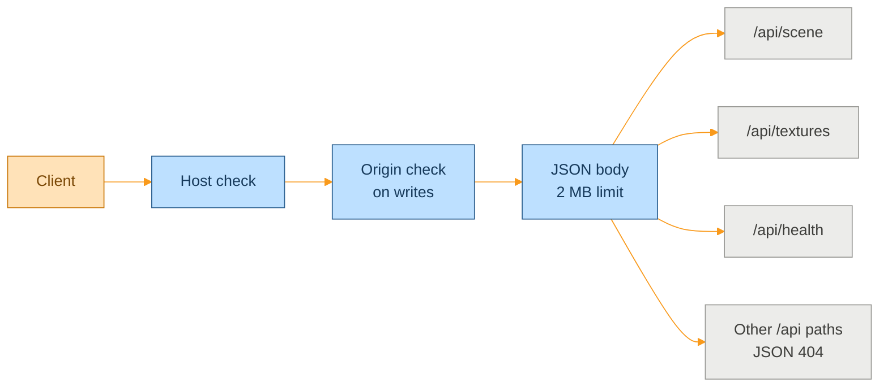

<p align="center">
  <picture>
    <source media="(prefers-color-scheme: dark)" srcset="assets/brand/header-strip-dark.svg">
    
  </picture>
</p>

# API

Every endpoint of the Express server. The base path is `/api`, bodies are JSON unless stated, and errors have the shape `{ "error": "<message>" }`, except where the answer is an empty body. The scene editor and the walkthrough are its only clients.



## Rules that apply everywhere

> [!WARNING]
> There is no authentication. The server binds to `127.0.0.1` by default, and the Host and Origin checks are what stand between the API and a hostile web page. Do not expose it to a network you do not trust.

- A request whose `Host` hostname is not loopback, the configured `HOST` or in `ALLOWED_HOSTS` gets `403 forbidden host`.
- A write (anything but `GET`, `HEAD` or `OPTIONS`) with an `Origin` header whose host differs from the `Host` header gets `403 forbidden origin`. Requests with no `Origin`, such as `curl`, pass.
- Every response carries `X-Content-Type-Options: nosniff`, `Referrer-Policy: no-referrer` and a content security policy. `X-Powered-By` is removed.
- Malformed JSON answers `400 bad request`, and a body over 2 MB answers `413 payload too large`.
- A storage failure or any unhandled error answers `500 internal server error`. The message is logged and never returned.
- Unknown `/api` paths answer `404 {"error":"not found"}`, never the app shell.
- Texture ids are UUIDs, generated by the server.

## Health

| Request | Answer |
|---|---|
| `GET /api/health` | `200 { "ok": true }` while the process can answer. The Docker health check uses it |

## Scene

The scene document is saved as `scene.json`:

```json
{ "bodies": [], "faces": [], "lights": [], "hour": 12 }
```

| Request | Body | Answers |
|---|---|---|
| `GET /api/scene` | none | `200` with the stored document. A missing or corrupt file yields the empty default scene, never an error. `500` when the data folder is unreadable |
| `PUT /api/scene` | The full scene document | `204` once the write is durable. `400 invalid scene payload: <path>` when validation fails, and nothing is written. `413` over 2 MB. `500` on a storage failure |

<details>
<summary>Validation limits</summary>

| Field | Rule |
|---|---|
| `bodies`, `faces` | Arrays of at most 5000 items |
| `lights` | Array of at most 200 items |
| `hour` | Finite number from 0 to 24, both included |
| `BodyPaint` | `bodyName` is a string of 1 to 256 characters, `textureId` is a UUID |
| `FacePaint` | `bodyName` as above, `seedTriIndex` is an integer from 0 to 1e9, `normalToleranceDeg` is a finite number from 0 to 180, `textureId` is a UUID |
| `UserLight` | `id` is a string of 1 to 256 characters, `shape` is `box`, `sphere` or `spot`, `position` is three finite numbers within +/-1e6, `scale` within +/-1e4, `rotation` within +/-1e3, `color` is `#rgb`, `#rrggbb` or `#rrggbbaa`, `intensity` is finite from 0 to 1e4 |

- The first problem is reported as a path, such as `bodies[3] is invalid`: the index, not the field.
- The stored copy keeps only the known fields. Unknown keys are dropped at every level.
- A texture id that is not in the manifest is not checked here. The client replays paints and skips the ones whose texture is missing.

</details>

## Textures

A texture record is `{ id, filename, scale, createdAt, mimeType }`. `scale` is the tile size in meters (1.0 by default), `createdAt` is in milliseconds, and `mimeType` is derived from the file's bytes.

| Request | Body | Answers |
|---|---|---|
| `GET /api/textures` | none | `200` with an array of records. A missing or corrupt manifest yields `[]` |
| `GET /api/textures/:id` | none | `200` with the image bytes. `400 invalid texture id` for a malformed id. `404` with an empty body when the id is unknown or its file is missing |
| `POST /api/textures` | `multipart/form-data` with exactly one field named `file` | `201` with the new record. `400 missing file` when there is none, `400 invalid upload` for any other upload error. `413 file too large` above 25 MB. `415` when the bytes are not an allowed image |
| `PATCH /api/textures/:id` | `{ "scale": number }` | `200` with the updated record. `400` for a malformed id, a body that is not a JSON object, or a scale outside 0.01 to 100. `404` with an empty body for an unknown id |
| `DELETE /api/textures/:id` | none | `204` whether or not the texture existed. `400 invalid texture id` for a malformed id |

Uploads are stricter than they look:

- Allowed types are PNG, JPEG, WebP, GIF and AVIF. SVG and HEIC are refused. The declared `Content-Type` and extension are ignored, and the file's magic bytes decide.
- The stored filename is the base name, cut to 200 characters. It is decoded as UTF-8, so `pared_año.jpg` stays intact.
- Nothing is written before validation passes. The file is written first and the manifest second.
- `PATCH` accepts only `scale` and drops other keys.

A download is sent with the stored type (or `application/octet-stream` when it is not on the allow-list), `X-Content-Type-Options: nosniff`, a locked-down `Content-Security-Policy: default-src 'none'; sandbox`, and `Cache-Control: private, max-age=31536000, immutable`, since the bytes of an id never change.

## Outside `/api`

| Path | Behaviour |
|---|---|
| `/models/*` | Read-only static files from `MODELS_DIR` when that folder existed at startup. Otherwise, and for a missing file, `404` with an empty body. It never falls through to the app |
| Anything else (`GET`) | When `dist/` exists: static files, and `index.html` for any path without a file extension. A path with an extension that misses is a `404`. Without `dist/` the server is API-only |

## Trying it

```bash
curl http://localhost:3001/api/health
curl http://localhost:3001/api/scene
curl -F "file=@brick.jpg" http://localhost:3001/api/textures
```

With `npm run dev` the API listens on 3001 and Vite proxies `/api` from 5173. A few more examples live in the tests, which double as a specification: see [TESTING.md](TESTING.md).

---

<p align="center">
  <a href="../README.md">Back to the README</a> · Previous: <a href="CONTROLS.md">Controls</a> · Next: <a href="TESTING.md">Testing</a>
</p>
