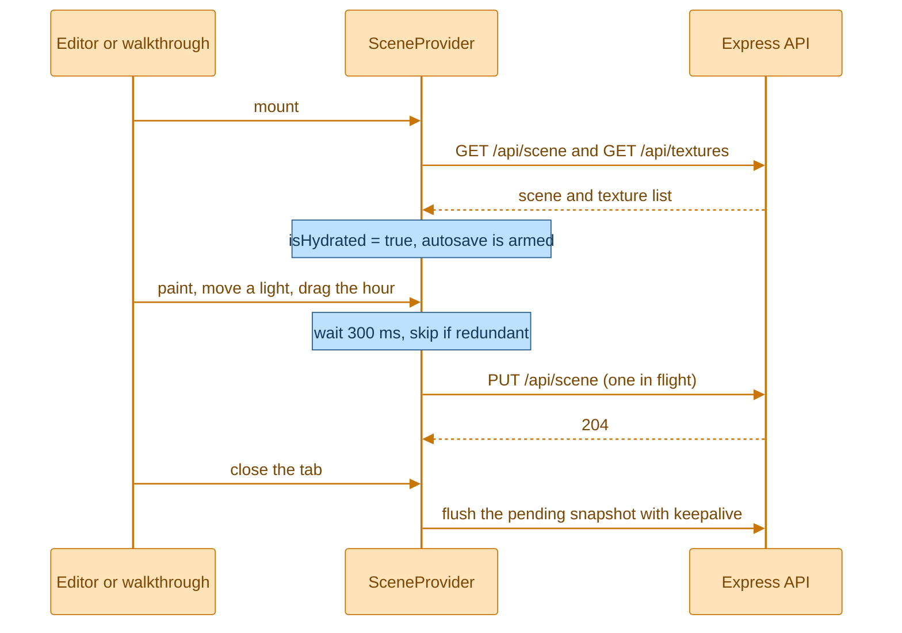
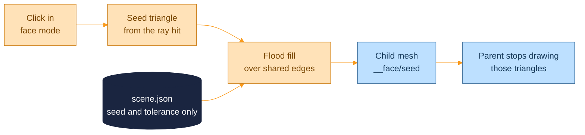
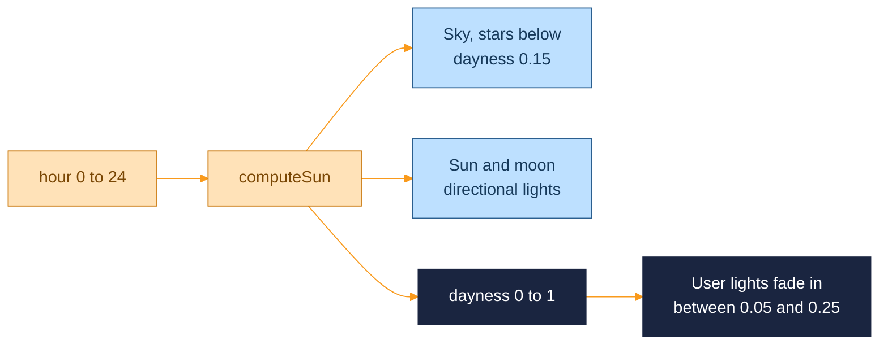
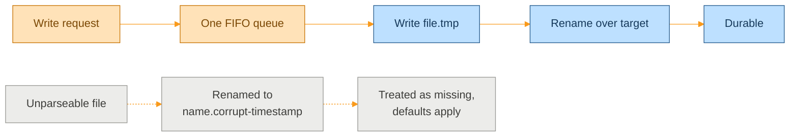

  <picture>
    <source media="(prefers-color-scheme: dark)" srcset="assets/brand/header-strip-dark.svg">
    
  </picture>

# Architecture

How the pieces fit, and the invariants that are easy to break. Paths are relative to the repository root.

<picture>
  <source media="(prefers-color-scheme: dark)" srcset="assets/diagrams/architecture-dark.svg">
  
</picture>

There is one `package.json`, one browser app in `src/`, one small API in `server/`, and a `shared/` folder of types that both sides import. The browser owns the interesting work (rendering, painting, lighting). The server only stores a scene and some images, and says no to anything that looks wrong.

## Frontend

The app is a React 19 single page app with three routes. `/` is the landing page and the only route that does not load three.js. `/walkthrough` and `/texture-tool` (shown as "Scene Editor") are lazy imports, so the heavy chunk is fetched only when someone enters a scene. Unknown paths render the landing page.

| Folder | Holds |
|---|---|
| `src/pages/` | `LandingPage`, `WalkthroughPage`, `TextureToolPage` |
| `src/routes/` | One module per scene route, wrapping its page in its own `SceneProvider` |
| `src/components/` | Atoms, molecules and organisms: buttons and keys, sliders and segmented controls, the texture and light panels |
| `src/features/scene/` | `SceneProvider`, the API client, the save tracker and the scale patcher |
| `src/features/painting/` | Triplanar material, flood fill, per-face meshes, paint replay |
| `src/features/house/` | Model loading, units, materials, framing |
| `src/features/lighting/` | The sun model, user lights, the time of day |
| `src/features/fps/` and `controls/` | First-person movement and the editor's orbit camera |
| `src/features/notifications/` | Toasts for failures that deserve a sentence |
| `shared/sceneTypes.ts` | Types only, imported by the browser and the server |

State is plain React context: `SceneProvider` for everything that persists, `NotificationsProvider` for toasts. There is no state library. Selection and panel modes in the editor are local and are not saved.

Build splitting and renderer defaults

Vite groups the bundle into `react`, `three` and `r3f` chunks. The `three` chunk is about 1.1 MB, so the chunk size warning limit is raised to 1200 KB.

Both scene routes import `features/scene/rendererSetup`, which calls `RectAreaLightUniformsLib.init()` once. Without it every box light renders black and nothing reports an error.

The shared canvas configuration uses PCF soft shadows, a pixel ratio between 1 and 1.5, antialiasing, ACES filmic tone mapping, and a camera from 0.05 to 500 meters.

## How a scene is saved

`SceneProvider` is the single source of truth for bodies, faces, lights, the hour and the texture list. Saving is built around one promise: the empty default state can never overwrite the server copy.

- Autosave is armed only after hydration. A failed load shows an alert with a retry button and nothing is saved.
- Changes are debounced for 300 ms, then chained: at most one scene `PUT` is in flight, so the server applies snapshots in order.
- On `beforeunload`, `pagehide` and unmount the pending snapshot is sent at once with `keepalive`, but only when its encoded body is under 60 KB, because browsers cap keepalive bodies at 64 KiB. `sendBeacon` cannot be used since it only sends `POST`.
- `saveTracker` remembers the newest acknowledged snapshot and the newest one handed to the server, and drops a snapshot only when it matches the latter. A revert to the acknowledged state while a newer save is in flight is therefore still sent.

Texture changes skip the debounce. An upload goes one file at a time. A delete asks the server first and removes the texture and every paint that uses it only after the server confirms. A scale change updates the screen immediately and sends a debounced `PATCH`, with at most one request per texture in flight and a rollback to the last accepted scale if the server refuses.

## Painting

Two kinds of paint live in the scene document. A body paint is a texture on every mesh under a named node, at most one per body. A face paint is a texture on one flat patch of a body, identified by the body name and a seed triangle.

### Triplanar projection

Painted meshes use a `MeshStandardMaterial` patched through `onBeforeCompile`. Only the base color sampling changes, so lighting, shadows and area lights keep working. The texture is sampled three times, projected along each axis from the world position, and blended by the surface normal raised to the fourth power. UVs are never read, which matters because CAD exports rarely carry usable ones.

The scale is in meters: a scale of 1 repeats the texture every meter. Changing it only updates a uniform, so there is no shader recompile. Textures are loaded as sRGB with repeat wrapping, and the cache stores promises so concurrent requests share one load and a failed load is retried on the next call.

### Faces by flood fill

A face is found by walking triangles that share an edge with the seed and whose normal stays within a tolerance of the seed normal (5 degrees by default). Vertices are matched by position rounded to 0.1 mm, because FBX files duplicate vertices along material and UV seams.

- Triangle numbers always address the original index buffer. The live buffer is rewritten as faces are painted, so it cannot be used to find an original triangle.
- Only the seed and the tolerance are stored. The faces are rediscovered on every load, so a saved scene stays small, and a seed that no longer exists in a re-exported model is skipped with a warning.
- A painted face is a child mesh that shares the parent's vertex attributes and owns only its index. The parent keeps a working index with those triangles removed and its draw range cut to match.

Why the bookkeeping is the way it is

- The working index is rewritten in place for the life of the body. `BufferAttribute.dispose()` does nothing in the WebGL renderer, so replacing the buffer on every paint would leak one GPU buffer per change.
- Geometry groups are rebuilt from the saved originals after every change, because group offsets are in indices and removing triangles shifts every later group. Skipping that draws the wrong triangles with the wrong material and breaks raycasting on multi-material meshes.
- Disposing a face detaches the shared attributes before disposing the geometry, otherwise the parent's buffers are freed underneath it.
- Replaying paints runs through a latest-wins runner per scene root: one run in flight, a newer call replaces any call still waiting, and the running pass is told it is stale and stops at its next checkpoint. Each scene root has its own runner, so the editor and the walkthrough never cancel each other.
- The house is deep-cloned on every mount. A shallow clone shares geometry by reference and painting mutates the parent index, so paints would leak between mounts and show up as holes in the other view.

## Houses

The model comes from `VITE_HOUSE_URL`, read once at import. `.glb` and `.gltf` use `GLTFLoader`; anything else uses `FBXLoader`. After loading, the house is normalised:

- **Units.** The largest bounding box extent decides: above 10000 means millimeters, above 100 centimeters, otherwise meters.
- **Up axis.** For FBX only, the shortest extent is taken as up and the model is rotated to match. glTF is Y-up by specification, so the guess is skipped.
- **Ground.** The top of the first mesh whose name contains a ground hint, or else the lowest point of the model, is placed at height zero, and the footprint is centered on the origin.
- **Materials.** Missing material slots get a grey fill, because a hole crashes the raycaster. Other material types are converted to standard materials so area lights can light them. Everything is forced opaque and double sided, since inverted winding in some exports would render black.

The bundled demo house is generated by `npm run build:demo-house` from Kenney's Building Kit with `@gltf-transform`: a grid of 2 m cells holding a living room, a bedroom and a bathroom, with a 60 m ground plane. The output is deterministic.

## Light and sun

`computeSun(hour)` is a pure function. The sun's elevation follows `sin((h - 6) / 12 * PI)`, its azimuth sweeps from east to west, and a `dayness` value from 0 to 1 blends the sky, the ambient light and the hemisphere light between night and day colors. A moon fill sits opposite the sun. Position arrays are created fresh on every call, because react-three-fiber compares array props by reference and a reused array would freeze the sky.

- The sun casts a 2048 pixel shadow map and only while its intensity is above a small threshold. The moon adds fill without shadows.
- User lights come in three shapes: `box` is an area light, `sphere` a point light and `spot` a downward spot light. They fade in with a smoothstep as the sun goes down, so they are fully on at night and off by day. Box lights do not cast shadows, a limitation of area lights in three.js.
- The light being edited carries a transform gizmo with a 5 degree rotation snap, and Shift turns the snap off. In the walkthrough the lights shine but have no visible mesh.
- `VITE_SUN_PATH_ROTATION_DEG` rotates the sun's arc around the vertical axis, so sunrise and sunset can line up with a real facade.

## Server

`createApp()` builds the Express app without binding a port, so tests drive it with supertest and `server.ts` starts it. Middleware runs in a fixed order, and the first two steps exist because the API has no login.

1. Baseline security headers and a content security policy on every response.
2. A `Host` allow-list (a defence against DNS rebinding) and, for writes, an `Origin` check (a defence against cross-site requests). Both answer `403`.
3. `express.json` with a 2 MB limit.
4. The `/api` routes, and a JSON `404` for unknown `/api` paths so they never fall to the app shell.
5. `/models`, a read-only static mount of `MODELS_DIR`.
6. The built app from `dist/`, with `index.html` as the fallback for paths without a file extension.
7. An error handler that logs the message and never returns it.

The entry point binds `HOST` and `PORT`, and on `SIGTERM` or `SIGINT` it stops accepting connections, waits for queued writes to finish, and exits. A ten second timer forces the exit if something hangs.

### Storage

Everything is files under `DATA_DIR`: `scene.json`, `textures/manifest.json` and one blob per texture in `textures/blobs/<uuid>`.

- Writes are atomic: a temporary file is written and renamed over the target, and removed if anything fails.
- Every write goes through one FIFO queue, so there must be one server process per data folder. Manifest updates run read-modify-write inside the queue.
- A texture upload writes the blob first and the manifest second. A crash between the two leaves an unreferenced blob, never a manifest entry that points at nothing.
- An unparseable JSON file is renamed aside and treated as missing, so one bad write degrades to defaults instead of locking the app.
- At startup the server removes leftover temporary files and blobs that the manifest does not mention.
- Texture ids are UUIDs checked before any handler runs, so a path fragment never reaches the filesystem.
- The stored image type comes from the file's magic bytes (PNG, JPEG, GIF, WebP, AVIF), never from the client's `Content-Type` or filename. SVG is refused on purpose, since it can carry script.

Validators are hand-written and return the first problem as a short path such as `lights[3] is invalid`. They also return a copy with only known fields, so unknown keys never reach disk. Limits and answers are in [API.md](API.md).

## Social preview

Crawlers ignore relative image URLs, so a small Vite plugin (`vite-plugins/socialMeta.ts`) rewrites the `og:image` and `twitter:image` values to absolute ones when `VITE_SITE_URL` is set, and adds `og:url`. Without it the tags are left as they are.

---

  <a href="../README.md">Back to the README</a> · Next: <a href="ENVIRONMENT.md">Environment</a>

