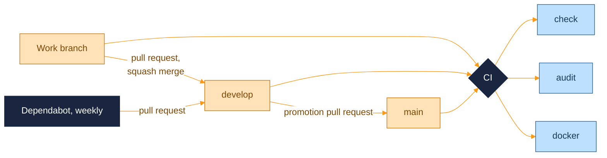

<p align="center">
  <picture>
    <source media="(prefers-color-scheme: dark)" srcset="assets/brand/header-strip-dark.svg">
    
  </picture>
</p>

# CI

One GitHub Actions workflow and a Dependabot configuration. The files are `.github/workflows/ci.yml` and `.github/dependabot.yml`. There is no deploy workflow: the project ships as a Docker image that you build and run yourself.



## The workflow

It runs on every pull request into `develop` or `main` and on every push to them, with read-only `contents` permission.

- **Concurrency.** For a pull request the group is the ref, and a newer push cancels the run in progress. For a push the group includes the commit, so every commit on `develop` and `main` keeps its own result.
- **Pinned actions.** Actions are pinned by commit SHA with the version in a comment, and checkout does not persist credentials.
- **Job names matter.** Branch protection requires `check`, `audit` and `docker` by name, so renaming one detaches it from the rule.

| Job | Timeout | Steps |
|---|---|---|
| `check` | 15 min | Checkout, Node 22 with the npm cache, `npm ci`, `npm run lint`, `npm test`, `npm run build` (typecheck of the app, server and shared types, then the Vite bundle), `npm run build:server` |
| `audit` | 10 min | Checkout, Node 22, `npm audit --audit-level=low`. It fails on any advisory, low severity and development dependencies included, and audits the lockfile as committed |
| `docker` | 15 min | Checkout and `docker compose build`, which builds the same image compose runs, with the bundled demo house |

> [!NOTE]
> Not in CI: a coverage threshold, the screenshot pipeline, an image scan and any deploy.

To run the same checks before pushing:

```bash
npm run lint
npm test
npm run build
npm run build:server
npm audit --audit-level=low
```

## Dependabot

Weekly update pull requests, all aimed at `develop` so they pass through the same checks and promotion as any other change.

| Ecosystem | Grouping |
|---|---|
| `npm` | One `minor-and-patch` group per week. Major versions arrive as separate pull requests |
| `github-actions` | None |
| `docker` | None. It bumps the pinned Node base image |

The audit job is strict, so a Dependabot pull request that does not clear an advisory leaves `audit` red until it does.

## Branch flow

- `main` is stable and receives promotions from `develop`.
- `develop` is the integration branch. Day-to-day pull requests target it and are squash-merged.
- Work branches are named by the type of change: `feat/...`, `fix/...`, `chore/...`, `ci/...`, `docs/...`.
- A squash merge turns the pull request title into the commit subject, so titles follow conventional commits.

---

<p align="center">
  <a href="../README.md">Back to the README</a> · Previous: <a href="TESTING.md">Testing</a> · Next: <a href="ROADMAP.md">Roadmap</a>
</p>
