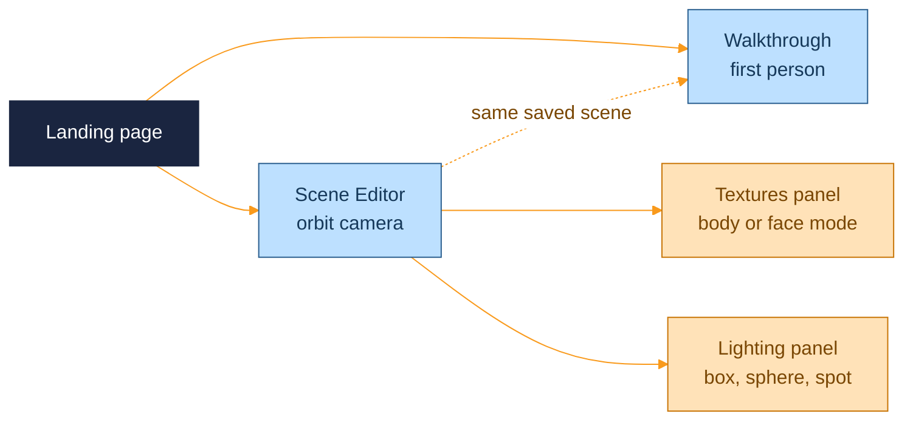

  <picture>
    <source media="(prefers-color-scheme: dark)" srcset="assets/brand/header-strip-dark.svg">
    
  </picture>

# Controls

Keyboard and mouse for the two scenes. The interface labels are in Spanish for now, so this page lists the key first and the action in English.

## Walkthrough

Click the instructions card, or press `Enter` or `Space` while it has focus, to lock the pointer and start walking. Movement is planar with no gravity and no collisions, so you can walk through walls: this is a viewer, not a game. The eye is at 1.7 m.

| Input | Action |
|---|---|
| `W` `A` `S` `D` | Move |
| Mouse | Look around |
| `Shift` | Sprint, 5 m/s instead of 2.2 m/s |
| `↑` and `↓` | Fly up and down at 3 m/s |
| `[` and `]` | Move the hour back and forward by 30 minutes |
| `G` | Toggle the grid helper |
| `H` | Toggle the axes helper |
| `Esc` | Release the pointer |

The crosshair and the controls reminder show while the pointer is locked. The time slider shows while it is released, so you can drag the hour with the mouse once you step out. The walkthrough starts at `VITE_HOUSE_SPAWN`.

## Scene Editor

The editor uses an orbit camera with the buttons remapped the way Fusion 360 does it, so the left button stays free for painting and selecting. The right button does nothing.

| Input | Action |
|---|---|
| Middle button drag | Pan the camera |
| `Shift` and middle button drag | Orbit the camera |
| Mouse wheel | Zoom (the direction is inverted) |
| Left click in the Textures tab | Paint with the selected texture |
| Left click in the Lighting tab | Select a light |
| Gizmo handles | Move, rotate or scale the selected light |
| `Shift` while rotating | Turn the 5 degree snap off |
| `Esc` | Deselect the texture and the light |

### Textures tab

Upload an image, select it in the grid, then choose how to paint:

| Mode | What a click does |
|---|---|
| Body | Paints the whole named body under the cursor |
| Face | Paints one flat face, found by flood fill from the triangle you clicked. Clicking an already painted face swaps its texture |

Each texture has a scale in meters: a scale of 1 repeats the image every meter. Deleting a texture also removes every paint that uses it.

### Lighting tab

Add a box, sphere or spot light, select it in the list or in the scene, then use the gizmo to move, rotate or scale it. Each light has a color, an intensity, a clone button and a delete button. Lights switch on as the sun goes down and are off by day.

### Time of day

The hour slider runs from 0 to 24 in quarter-hour steps and is shared by both scenes. Whatever hour you leave in the editor is the hour the walkthrough opens at.

---

  <a href="../README.md">Back to the README</a> · Previous: <a href="ENVIRONMENT.md">Environment</a> · Next: <a href="API.md">API</a>

