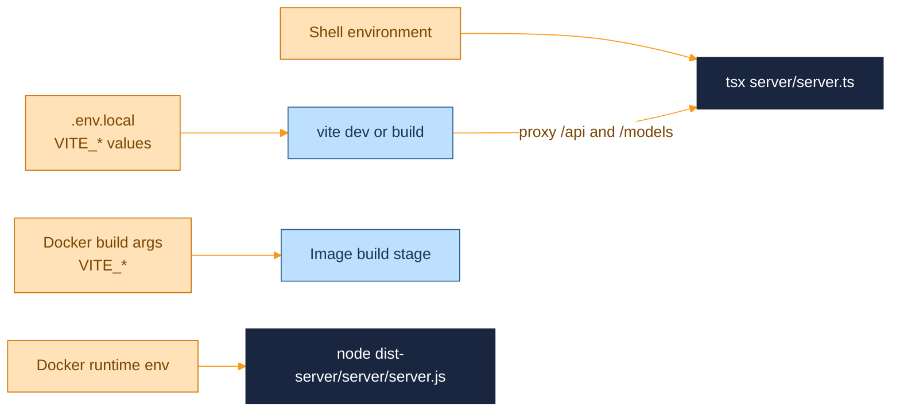

  <picture>
    <source media="(prefers-color-scheme: dark)" srcset="assets/brand/header-strip-dark.svg">
    
  </picture>

# Environment

Every variable, script, port and Docker detail. Commands run from the repository root. Everything is optional: with no configuration at all, `npm install` and `npm run dev` give you the demo house on http://localhost:5173.

> [!IMPORTANT]
> `VITE_*` values are inlined at build time. Changing one needs a restart of `vite` or a rebuild of the image. Server variables are read at runtime.

The only tracked environment file is `.env.example`, which lists every variable. Copy it to `.env.local` (git-ignored, like `.env` and `.env.*`) to override defaults.

## Client variables

Build time, read by Vite

| Variable | Default | Effect |
|---|---|---|
| `VITE_HOUSE_URL` | `/demo/house.glb` | Model to load. `.fbx` uses the FBX loader, `.glb` and `.gltf` the glTF loader. A blank value falls back to the default |
| `VITE_HOUSE_SPAWN` | `-2,0` | Walkthrough spawn as `x,z` in meters, in the recentered model's coordinates (0,0 is the middle of the footprint). Anything that is not two finite numbers falls back to the default |
| `VITE_HOUSE_GROUND_HINTS` | empty | Comma-separated mesh name fragments, case-insensitive, that identify the ground. The top of the first match is placed at `y = 0`. With none, the lowest point of the model is used |
| `VITE_SUN_PATH_ROTATION_DEG` | `0` | Rotation of the sun's arc around the vertical axis, in degrees. 0 rises at +X, 90 rises at +Z |
| `VITE_SITE_URL` | empty | Public base URL, origin plus an optional sub-path. Makes `og:image` and `twitter:image` absolute and adds `og:url`. Invalid values warn and are ignored |

## Server variables

Runtime

| Variable | Default | Effect |
|---|---|---|
| `HOST` | `127.0.0.1` | Bind address. Loopback by default because the API has no authentication. The Docker image sets `0.0.0.0` |
| `PORT` | `3001` | API port. `vite.config.ts` reads it too, to point the dev proxy |
| `DATA_DIR` | `server/data` | Where `scene.json` and `textures/` live. The Docker image sets `/data` |
| `MODELS_DIR` | unset | Folder served read-only at `/models/`. It is checked once at startup, so create it first. The Docker image sets `/models` |
| `ALLOWED_HOSTS` | unset | Extra hostnames accepted in the `Host` header, comma separated. Ports and case are ignored |

Host rule: loopback names are always accepted, plus `HOST` unless it is `0.0.0.0` or `::`, plus everything in `ALLOWED_HOSTS`. Anything else gets `403 forbidden host`. Reaching the app by a LAN address therefore needs `ALLOWED_HOSTS=<that address>`.

## Scripts

Every npm script

| Script | Runs | Notes |
|---|---|---|
| `dev` | Vite and the API together | Colour-coded output, and one exit stops both |
| `dev:vite` | `vite` | Dev server on 5173 |
| `dev:api` | `tsx watch server/server.ts` | API on `HOST:PORT` |
| `typecheck` | `tsc -b` | App, tooling and server projects |
| `build` | typecheck, then `vite build` | Output in `dist/` |
| `build:server` | `tsc -p server/tsconfig.build.json` | Output in `dist-server/` |
| `build:demo-house` | `node scripts/build-demo-house.mjs` | Rewrites `public/demo/house.glb` |
| `start` | `tsx server/server.ts` | |
| `start:prod` | `node dist-server/server/server.js` | Needs `build:server`, and serves `dist/` when it exists |
| `test`, `test:watch`, `test:coverage` | Vitest | See [TESTING.md](TESTING.md) |
| `lint` | `eslint .` | |
| `preview` | `vite preview` | |
| `showcase:install`, `showcase:seed`, `showcase:capture`, `showcase:gif` | The screenshot pipeline | See [TESTING.md](TESTING.md#the-showcase-pipeline) |

## Dev ports and proxy

Vite runs on http://localhost:5173 and the API on http://127.0.0.1:3001. Vite proxies `/api` and `/models` to the API, and after `npm run build` the API alone serves the whole app on 3001.

- The proxy targets the literal loopback address, because `localhost` can resolve to `::1` first on some systems.
- `changeOrigin` is off on purpose. The API rejects a write whose `Origin` differs from its `Host`, so the browser's `Host` (`localhost:5173`) has to reach the API unchanged. Turning it on makes every `PUT`, `POST`, `PATCH` and `DELETE` fail with `403 forbidden origin`.
- The Vite watcher ignores `server/data`, so autosaves do not trigger reloads.

## Bring your own house

The bundled house is a CC0 demo. Any FBX or glTF file can replace it, and models are never committed: `*.fbx` is ignored by git and by Docker.

In development:

1. Put the model in a folder, for example `./models/MyHouse.fbx`.
2. Start the API with `MODELS_DIR=./models`. The Vite proxy forwards `/models` to it.
3. Set `VITE_HOUSE_URL=/models/MyHouse.fbx` in `.env.local`, plus `VITE_HOUSE_SPAWN`, `VITE_HOUSE_GROUND_HINTS` and `VITE_SUN_PATH_ROTATION_DEG` if the model needs them, and run `npm run dev`.

With Docker:

1. Build with `VITE_HOUSE_URL=/models/MyHouse.fbx` as a build argument. The commented lines in `docker-compose.yml` show where.
2. Mount the file read-only, for example `./models/MyHouse.fbx:/models/MyHouse.fbx:ro`. The image already sets `MODELS_DIR=/models`.
3. Run `docker compose build` and `docker compose up -d`. Rebuild after any `VITE_*` change.

> [!NOTE]
> Paints are stored against the model's node names. Swapping in a different model leaves the old paints without a target: a stale face is skipped with a console warning and an unknown body is skipped silently.

Units, the up axis, the ground level and missing materials are handled at load time, as described in [ARCHITECTURE.md](ARCHITECTURE.md#houses).

## Docker

The image is a multi-stage build on `node:22-alpine`: `deps` installs everything, `prod-deps` installs production dependencies only, `build` runs the frontend and server builds, and `runtime` copies the results. It runs as the unprivileged `node` user, declares `/data` as a volume, exposes 3001, and has a health check that calls `/api/health` every 30 seconds.

Build arguments are the five `VITE_*` variables. Runtime defaults are `NODE_ENV=production`, `HOST=0.0.0.0`, `PORT=3001`, `DATA_DIR=/data` and `MODELS_DIR=/models`.

`docker-compose.yml` runs one service with a hardened profile:

| Setting | Why |
|---|---|
| `127.0.0.1:3001:3001` | The API has no authentication, so the port is published on loopback only |
| `read_only: true` with `tmpfs: /tmp` | The app only writes to `/data` |
| `cap_drop: ALL` and `no-new-privileges` | Nothing needs a capability |
| `init: true` | Forwards `SIGTERM`, so the graceful shutdown runs instead of waiting for the kill timeout |
| `walkthrough-data` volume on `/data` | Scenes and textures survive a rebuild |
| `restart: unless-stopped` | Comes back after a reboot |

To reach the container from another machine, put a reverse proxy in front of it, or set `ALLOWED_HOSTS` and change the port binding on purpose.

## Data on disk

`DATA_DIR` holds `scene.json`, `textures/manifest.json` and `textures/blobs/<uuid>`. Back up the whole folder, or the Docker volume. A corrupt JSON file is moved aside as `*.corrupt-<timestamp>`, and what happens at startup is in [ARCHITECTURE.md](ARCHITECTURE.md#storage).

## When something stalls

| Symptom | Check |
|---|---|
| `403 forbidden host` | The `Host` header is not in the allow-list. Use `localhost`, or set `ALLOWED_HOSTS` |
| `403 forbidden origin` on saves in dev | The proxy has `changeOrigin` turned on, or another origin is calling the API |
| `EADDRINUSE` at startup | Port 3001 is taken. The server logs it and exits with code 1 |
| `/models/...` answers 404 | `MODELS_DIR` is unset, the folder did not exist at startup, or the file name differs |
| Box lights render black | `RectAreaLightUniformsLib.init()` did not run. It lives in `rendererSetup.ts` |
| Holes where editor faces were painted | Geometry was shared between two house mounts. The house is deep-cloned for this reason |

---

  <a href="../README.md">Back to the README</a> · Previous: <a href="ARCHITECTURE.md">Architecture</a> · Next: <a href="CONTROLS.md">Controls</a>

