  <picture>
    <source media="(prefers-color-scheme: dark)" srcset="assets/brand/header-strip-dark.svg">
    
  </picture>

# Roadmap

Planned improvements, in the order they are likely to land. Nothing here is a promise with a date: it is the shortlist of what would make Walkthrough Studio nicer to use and sturdier to keep.

```mermaid
%%{init: {"theme": "base", "themeVariables": {"fontFamily": "Segoe UI, Helvetica, Arial, sans-serif", "primaryColor": "#ffe2b8", "primaryBorderColor": "#c97608", "primaryTextColor": "#7a4704", "lineColor": "#f99a1c", "textColor": "#7a4704", "edgeLabelBackground": "#ffffff"}}}%%
flowchart LR
  I["Spanish and English<br/>interface"] --> D["Gentler storage<br/>cleanup"]
  D --> S["Saves that never<br/>disagree with the screen"]
  S --> P["Faster painting on<br/>big models"]
  P --> E["Painting edge cases"]
  E --> L["Landing page<br/>and social polish"]
  classDef paint fill:#ffe2b8,stroke:#c97608,color:#7a4704
  classDef sky fill:#bde0ff,stroke:#2b5f8f,color:#16395a
  classDef night fill:#1a2540,stroke:#1a2540,color:#ffffff
  class I night
  class D,S paint
  class P,E,L sky
```

## 1. Spanish and English interface

The interface ships in Spanish today, while the code and the docs are in English. The plan is a language switch with both languages complete, so anyone can try the app without reading Spanish and Spanish speakers keep their wording.

What it needs: moving every visible string, including the notices and accessibility labels, into a message catalogue; picking the initial language from the browser; remembering the choice; and keeping `lang` on the page accurate. The key hints on the walkthrough card are part of it.

## 2. Gentler storage cleanup

At startup the server removes leftover temporary files and textures that the manifest does not mention. Two refinements would make that cleanup more careful about files it did not create or could still recover.

- Match only the exact temporary file names the app writes, so an unrelated file placed in the data folder is left alone.
- Keep unreferenced textures while a quarantined manifest backup exists, so a corrupt manifest can still be restored by hand. A grace period before purging would do the same job.

## 3. Saves that never disagree with the screen

Autosave is chained and debounced, and it already refuses to let an empty scene overwrite a saved one. A few narrow cases deserve tightening.

- Register each snapshot with the save tracker as soon as it is queued, so a quick revert while a slow save is in flight is always sent.
- Use `keepalive` only on the page-close path. Large scenes would then save normally instead of relying on a request type that browsers cap at 64 KiB.
- Make a failed texture-scale update show a single notice, with its error handling split from the success path.

## 4. Faster painting on big models

Every painted face rebuilds its parent's index, so loading many faces on a large FBX is slower than it needs to be. Batching the replay so each body is rebuilt once per pass would turn the work from per-face into per-body. A related cleanup is releasing the adjacency and index data cached on source geometry when a scene closes.

## 5. Painting edge cases

- A degenerate seed triangle with no surface normal should paint nothing instead of everything at wide tolerances.
- Faces painted at different tolerances can overlap. Skipping triangles that already belong to another face would settle it.
- A model's own draw range should be remembered and restored, not reset.

## 6. Landing page and social polish

- The orange bar under the landing title is a few pixels right of centre, because the letter-spaced title is shifted to balance its tracking.
- The tape strip should let the wheel and scrollbar through, the scroller should never show a horizontal bar, and mode cards need a focus style that matches their hover.
- The social meta plugin should either support deploying under a sub-path properly or stop advertising it, and cover more attribute forms in its tests.

## 7. Screenshot pipeline

The captures are good, and could be better: a closer framing of the house in the texture editor, more contrast on the dusk walls, an interior shot for the light editor, and a hero closer to six seconds. The pipeline could also check ports before it starts and keep a failed run from replacing the committed images. It is described in [TESTING.md](TESTING.md#the-showcase-pipeline).

---

  <a href="../README.md">Back to the README</a> · Previous: <a href="CI.md">CI</a>

