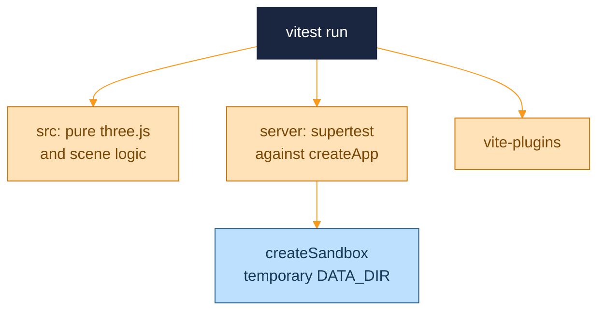
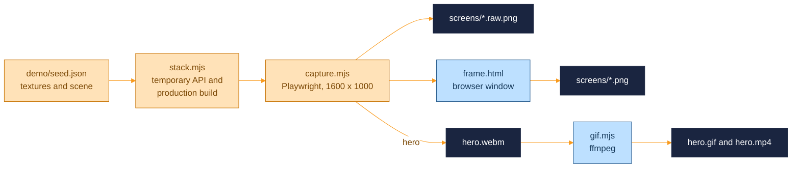

<p align="center">
  <picture>
    <source media="(prefers-color-scheme: dark)" srcset="assets/brand/header-strip-dark.svg">
    
  </picture>
</p>

# Testing

Vitest runs everything: pure three.js and scene logic on the frontend, the Express app through supertest on the server, and the Vite plugin. There are no component tests and no browser tests. A separate Playwright pipeline takes the README screenshots, and it is described at the end.



## Running the tests

| Command | Use |
|---|---|
| `npm test` | One run, which is what CI executes |
| `npm run test:watch` | Watch mode |
| `npm run test:coverage` | A run with coverage, written to `coverage/` as text and HTML |
| `npx vitest run server/__tests__/store.test.ts` | One file |

CI runs lint, the tests and both builds in one job, as described in [CI.md](CI.md). There is no coverage gate.

## Configuration

`vitest.config.ts` is separate from `vite.config.ts`, so the dev proxy and the React plugin never load in tests. The environment is `node` for everything, because the frontend modules under test are pure three.js math and the server tests drive Express directly. Only `*.test.ts` files are picked up, so a `.test.tsx` file would be ignored.

Coverage uses V8 with an explicit list of files, not a glob over `src`. A new module is not measured until it is added to the list.

## What each suite covers

<details open>
<summary>Frontend, next to the code in <code>src/</code></summary>

| File | Covers |
|---|---|
| `painting/floodFill.test.ts` | Edge keys, adjacency by rounded position, indexing of triangle soup, the normal-tolerance walk, out-of-range seeds |
| `painting/faceManager.test.ts` | The face registry, working index and draw range, group rebuild, current-to-original mapping, disposal |
| `painting/latestWins.test.ts` | One run in flight, newest call wins, the stale signal, error isolation |
| `painting/paintApply.test.ts` | Reconciling body and face paints, restoring originals, stale runs |
| `painting/paintOps.test.ts` | Adding, replacing and retexturing paints |
| `house/framing.test.ts` | Camera distance and direction for a bounding box |
| `house/houseConfig.test.ts` | Environment parsing and fallbacks. It stubs `VITE_*` and re-imports the module, since the config is parsed once at import |
| `house/materialConverter.test.ts` | Converting other materials to standard ones, cached by uuid |
| `house/materialPatch.test.ts` | Missing material slots and group indices |
| `lighting/sun.test.ts` | `computeSun` and the hour formatter |
| `lighting/lightListOps.test.ts` | Patching, transforming and removing lights |
| `lighting/userLightTypes.test.ts` | Factories, clone offsets and the id generation fallbacks |
| `notifications/toastState.test.ts` | De-duplication, the cap of four, dismissal |
| `scene/saveTracker.test.ts` | Expected against acknowledged snapshots, out-of-order acknowledgements, failure |
| `scene/scalePatcher.test.ts` | Debounce, one request per texture, rollback, flush |
| `components/atoms/logoMarkGeometry.test.ts` | The logo mark geometry |
| `vite-plugins/socialMeta.test.ts` | Relative to absolute image URLs, `og:url`, comments, quoting, invalid bases |

</details>

<details>
<summary>Server, in <code>server/__tests__/</code></summary>

| File | Covers |
|---|---|
| `api.test.ts` | Health. Scene `GET` and `PUT`: the default, a round trip, unknown fields stripped, a rejected payload keeping the stored scene, malformed JSON, the 2 MB limit, a corrupt file, a storage failure. Texture upload: type from bytes, SVG refused, filename handling, missing file, wrong field, second file, 25 MB limit, the blob removed when the manifest fails. Texture ids and traversal attempts, download headers, scale `PATCH` with concurrent updates, idempotent `DELETE`. Security headers, the Host allow-list, the Origin check. Static serving, the app fallback, `/models` |
| `store.test.ts` | Paths from `DATA_DIR`, startup cleanup, normalisation, quarantine of corrupt files, atomic writes, write ordering and failing modifiers, the manifest, blobs |
| `validation.test.ts` | Texture id checks, number ranges, scene validation, scale patches |
| `imageType.test.ts` | Magic-byte sniffing for PNG, JPEG, WebP, GIF and AVIF, with HEIC, SVG and truncated input refused |

</details>

### Server helpers

`createSandbox()` creates a temporary directory, stubs `DATA_DIR` to it, resets the module registry and imports a fresh `store` and `app`. It is needed because `store.ts` reads `DATA_DIR` once at import, and without the reset every test would share the first folder. The real `server/data` is never touched. Call its `cleanup()` in `afterEach`.

The same file offers `makeTempDir` for static-file fixtures, a `binary` parser that keeps a response as a `Buffer`, the smallest buffer the sniffer accepts as a PNG, and a valid sample scene.

## What is not tested

- React components, pages and `SceneProvider`, so hydration, the autosave effect and the keepalive flush are covered only through the pure `saveTracker` and `scalePatcher`.
- Rendering: the triplanar shader, house loading, the controls and shadows.
- `server.ts`, which covers startup, signals and graceful shutdown.
- The demo house script and the Docker image, which CI only builds.
- Accessibility and visual checks.

## The showcase pipeline

The screenshots and the animation in the README are produced by a script, not by hand, so they can be retaken after every feature. The pipeline lives in `e2e/showcase/`, which has its own `package.json` so the app never depends on Playwright, and its own README with every detail.



```bash
npm run showcase:install
npm run showcase:capture
npm run showcase:gif
```

- It needs ffmpeg for the animation, and free ports 3917 and 5917 (or others in `SHOWCASE_API_PORT` and `SHOWCASE_WEB_PORT`). Nothing else has to be running, and a dev server on the usual ports is left alone.
- Every shot uses the bundled demo house. The temporary build passes every house variable explicitly, so a private model set in `.env.local` cannot reach a picture, and after each shot the script fails unless the only model the page requested was `/demo/house.glb`.
- The API runs on a fresh temporary `DATA_DIR`, so the repository's own data is never read or written. The scene comes from a versioned seed that is checked against the house before anything is uploaded, and the demo textures are CC0 files from Poly Haven.
- Stills are taken at a 1600 by 1000 window and twice the pixel density, saved raw and inside a browser frame. The hero is recorded in full Chromium and converted to a GIF within an 8 MB budget, and the script fails when the busiest second of the MP4 has fewer than 20 distinct frames.
- A shot fails when a notice, a dialog or a load error is on screen. Dialogs are never confirmed.

---

<p align="center">
  <a href="../README.md">Back to the README</a> · Previous: <a href="API.md">API</a> · Next: <a href="CI.md">CI</a>
</p>
