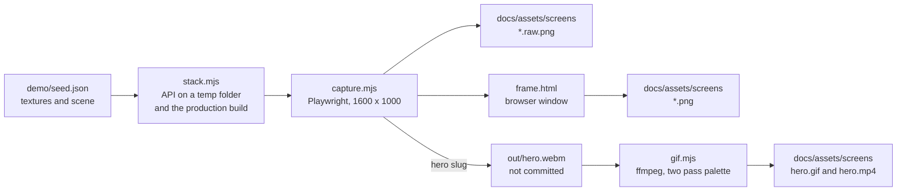

# Product captures

The screenshots and the animation in the repository README are produced by a script, not by hand. `capture.mjs` builds a private copy of the app, loads a fixed demo scene into it, drives it with a real browser and takes each shot, so the pictures always show the product as it is, with the same house, the same window size and the same frame. `gif.mjs` turns the recorded flow into the GIF and the MP4.



## Requirements

- The root dependencies installed (`npm ci`), because the pipeline builds the app and reads the house with them.
- Playwright and its Chromium, from the repository root: `npm run showcase:install`. It runs `npm ci` and `playwright install chromium` inside `e2e/`, which has its own `package.json` so the app never depends on Playwright.
- ffmpeg for the GIF and the MP4. Set `FFMPEG` to the executable when it is installed but not on the PATH.
- Ports 3917 and 5917 free, or others in `SHOWCASE_API_PORT` and `SHOWCASE_WEB_PORT`.

Nothing else has to be running. The pipeline starts and stops its own API and web server, so a development server on the usual ports is left alone.

## Running it

From the repository root:

```bash
npm run showcase:capture
npm run showcase:gif
```

`npm run showcase:capture` takes every still. `npm run showcase:gif` records the hero flow and converts it. From `e2e/` the same commands are `npm run showcase` and `npm run showcase:gif`.

| Variable | Default | Meaning |
|---|---|---|
| `SHOWCASE_OUT` | `docs/assets/screens` | Where the shots and the animation are written |
| `SHOWCASE_FRAME_SCALE` | `1.25` | The pixel density of the framed shots |
| `SHOWCASE_API_PORT` | `3917` | Port of the throwaway API |
| `SHOWCASE_WEB_PORT` | `5917` | Port of the throwaway web server |
| `SLUGS` | Every still | A comma separated list of slugs to capture. A slug may also be passed as an argument |
| `FFMPEG` | `ffmpeg` | The ffmpeg executable |

The script prints `OK` or `FAIL` for each shot and exits non-zero when any failed.

## The shots

| Slug | Shows | Output |
|---|---|---|
| `walkthrough-day` | First person view of the living room by day | `walkthrough-day.png` |
| `walkthrough-dusk` | The same view at 18:00, with the lamps on | `walkthrough-dusk.png` |
| `texture-editor` | The editor with the street facade painted face by face and a texture armed | `texture-editor.png` |
| `light-editor` | The lighting tab with a light selected and the transform gizmo | `light-editor.png` |
| `hero` | In the editor: pick Ladrillo, paint the west wall, move the clock from noon to night | `hero.gif`, `hero.mp4` |

Every still leaves two files: `<slug>.raw.png`, the screenshot at twice the pixel density, and `<slug>.png`, the same screenshot inside the browser frame.

## How the shots stay the same

The demo house is enforced, not assumed.

- `stack.mjs` builds the frontend into a temp folder with every house variable passed explicitly: `VITE_HOUSE_URL=/demo/house.glb` and the spawn, ground hints, sun rotation and site URL empty. Variables of the process win over `.env.local`, so a private model configured there cannot reach a picture.
- The API runs on `DATA_DIR` set to a fresh folder under the system temp directory and `MODELS_DIR` empty, so the repository's `server/data` and any mounted models are never read or written.
- After every shot the script checks which model files the page requested and fails the shot unless the only one is `/demo/house.glb`.
- A picture that is black or flat is rejected by a luminance check.

The scene comes from `demo/seed.json`, which names bodies and triangles of the real house. `seed.mjs` checks every name and triangle number against `public/demo/house.glb` before it uploads anything, so a rebuilt house makes the seed fail instead of painting nothing. The textures are in `demo/textures/`, with their sources in `demo/CREDITS.md`.

- The window is 1600 by 1000 and stills are taken at twice the pixel density. The 3D canvas itself caps its density at 1.5, as the app does.
- Every still starts from the same scene: the script writes it through the API before each shot, whatever the previous shot changed.
- First person mode is entered the way a person enters it, by clicking the instructions overlay, and the camera is aimed with relative mouse movement. The pitch is first pushed to its upward limit and then brought back a known distance, so the view is the same on every run. Time moves with the `]` key.
- The editor camera is positioned with the wheel and Shift plus the middle button, the controls the editor documents.
- A shot fails when a notice, a dialog or a load error is on screen.
- The hero is recorded in the full Chromium build (`channel: 'chromium'`, new headless mode) at a pixel density of 1. The default headless shell rasterizes in software and renders animation at a fraction of the display rate. The recorder keeps 25 frames a second, the MP4 is encoded at 25 and the GIF at 20 and 1100 pixels wide. All the stills use the same browser so that the pictures and the animation render alike.
- `gif.mjs` counts the distinct frames of the MP4 with `mpdecimate` and fails when the busiest second holds fewer than 20.

## Maintenance

- Rerun both commands at the close of each feature slice that changes a screen, and commit the images with the change.
- Never confirm a dialog. A dialog that opens is dismissed and fails the shot. The hero flow writes to the scene (it paints a wall and moves the clock), but only into the throwaway data folder, which is deleted when the run ends, so there is nothing to put back.
- A shot that needs a new screen is one more entry in `SHOTS` in `capture.mjs`: a slug, a title for the frame, the scene it starts from and a function that brings the page to the state to photograph.
- To change what the demo scene contains, edit `demo/seed.json`. Run `node showcase/seed.mjs` with `SHOWCASE_API` set to seed a running API by hand: it refuses an API that already holds a scene or textures unless `--force` is passed.
- The frame is `frame.html`: the window, the dots and the gradient are plain CSS and can be restyled without touching the script.
- The GIF has a budget of 8 MB. `gif.mjs` fails when it is over, and `WIDTH` and `FPS` at its top are the two levers.
